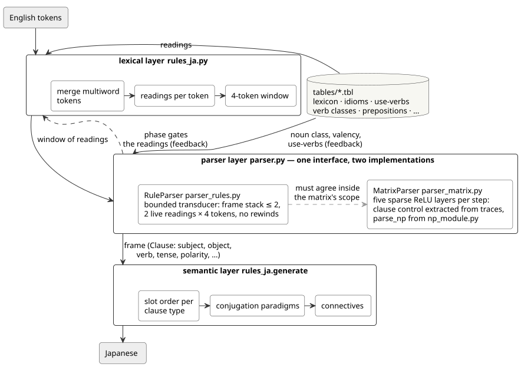
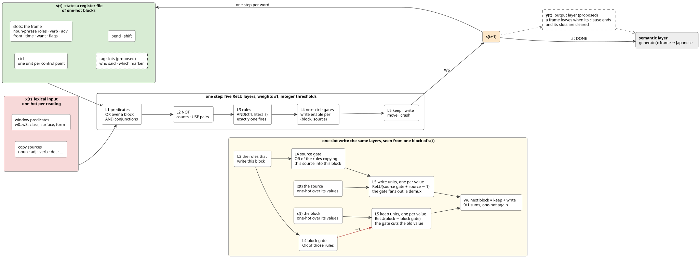
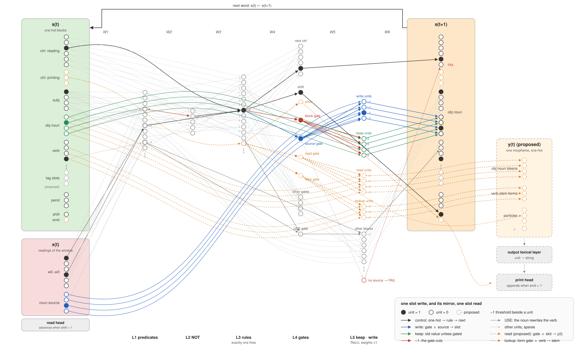

# RNNTranslator

RNNTranslator is an English-to-Japanese translator written as a circuit, not trained: a hand-written rule transducer whose parser and printer are compiled, module by module, into two cells of sparse ReLU matrices — an encoder that reads one token at a time and a decoder that prints one morpheme at a time. Hypothesis: a language is a small circuit of tables and bounded control, and such a circuit can be written down, verified exhaustively, and compiled into weights whose every nonzero has a name. It is evaluated on the Tanaka-corpus dev (496 sentences) and test (499 sentences) splits of small_parallel_enja, pinned by commit and hash.

## Architecture



The lexical layer merges multiword tokens and gives each token its readings from the 16 tables, and the semantic layer generates the Japanese from the frame. The parser layer has one interface and two implementations, `RuleParser` and `MatrixParser`, and the matrix implementation is meant to agree with the rule implementation wherever the matrix can represent the parse. `RuleParser` is a bounded transducer: a 4-token window, a frame stack of depth at most 2, at most 2 live readings resolved within 4 tokens, and no rewinds. The rule parser refuses an object-form or reflexive pronoun as a subject and a finite verb that disagrees in number with a pronoun or plural subject. `MatrixParser` runs the same machine as two recurrent cells of 5 sparse ReLU layers per step — an encoder that reads the sentence into frames and a decoder that prints from them — with the noun-phrase module, the PP machine, the predicate, the copula and the printing rules translated by hand and the rest of the clause-level control extracted from traces of the rule parser. Two feedback edges cross the layers: the noun's use-verb rewrites the verb (she took a rest → 彼女は休んだ), and the parser's state decides which reading of a token is used (i rest → 休む, i need a rest → 休息). The second edge is the lexical layer's part inside the encoder: the table rows that join the frame's verb with the window — the idiom tails, the particle after a verb, the use nouns — are AND units over the verb block and the window's table keys, ORed into the hit predicates the rules read, so the runner hands the encoder the window alone.

## Encoder, context, decoder





The compiled machine is two recurrent cells with a context between them: the encoder's state is a register file of one-hot blocks (the control point, the slots of the working frame, the pending preposition, and the shift and flush units), its input is one-hot over the readings of the window, and one step is 5 ReLU layers followed by a readout of zeros and ones into the next state; the decoder is a second cell of the same shape, whose state is the printing position, the sentence block, the emit, down and up units and the output morpheme, and whose input is one frame, unit for unit the encoder's slot block. In both cells every weight is plus or minus one, except a large negative weight that silences a rule whose literal the cell cannot see, and every bias is an integer threshold. The second picture is the two cells unit by unit, in the textbook style: circles are units, columns are the layers, arrows are the weights; in the encoder one write into the object block is traced in colour, in the decoder its mirror — a printing position, the emit unit, one slot read and one form lookup into the output — in orange, and between them the context, with the attention head on one of its frames. A slot write is a gated copy: the rules that write a block are ORed into a block gate and, per source, a source gate; the next layer holds one write unit per value, which fires when the source gate and that source value are both on, and one keep unit per value, which the block gate cuts; and the readout sums keep and write back into the block, so one gate fans a rule out over the values of a block as a demultiplexer and clears the old value in the same step. The decoder shares nothing with the encoder but the context: no unit of the encoder emits and no unit of the decoder reads a token; a reading rule consumes a token and writes slots, and a printing rule reads the frame under the attention and the sentence block, emits a morpheme or moves the attention, and writes no slot. The context is one frame per clause, in the order the clauses closed, and the sentence block of the encoder's final state: when the flush unit is on, the slot block of the encoder's state is appended to the context — at a clause boundary, where the frame first gets a link saying that a clause is spliced into it and the slots are then cleared, each by the gate that writes it, for the clause to be read into, and at the end of the sentence. The decoder reads the context by hard attention, one frame at a time: the attention head starts on the first frame and moves to the next or the previous one when the down or the up unit is on, so a that-clause is printed where Japanese wants it — the outer clause's subject and arguments, then down for the clause and と, then back up for the outer predicate — and a that-clause inside a that-clause is one more frame under the same rules. A question mark read after a that-clause, when the outer frame has already left the encoder, reaches the decoder in the sentence block. Hypothesis: because nothing is printed before the encoder is done, the decoder is free to print the frames in another order than they closed, which is what a subordinate clause that follows its main clause needs, and every inner clause the rule parser folds into a string is a frame with a link of its own kind. Every mechanism of the encoder has a mirror in the decoder — the shift unit that advances the read head mirrors an emit unit that advances the print head, the flush unit that appends a frame to the context mirrors the down and up units that move the attention over it, a write gate that fans a rule out over the values of a block mirrors a read gate that selects a block of the frame onto the output, the USE lookup that rewrites the verb from its noun mirrors a form lookup that selects the verb's stem form, the suffix following as a constant the flags choose, and a copy with no source mirrors a read with nothing in the block or a form the verb has not, both of which refuse. The output is one morpheme per step, a one-hot over slot values, verb and adjective stem forms, particles, suffixes and punctuation, summed by the readout from the read and lookup units, and an output lexical layer maps each unit to its string the way the input lexical layer maps each string to its readings. The printing rules are written in the normal form of the noun-phrase module — per position, an ordered decision over slot predicates whose terminals emit one token or move the attention: a constant morpheme, a slot's value, or a form of the verb or the adjective from the morphology table — and the `printer` action checks them against `generate()` on every sentence the rule parser parses and on a sweep of 167,985 frames over the predicates they test, a that-clause under a reporting verb and around a fixed inner clause among them, so the printer is one more chain of the lattice, agreeing with, refusing or misfiring against the rule generator on every sentence. The compiled machine runs unchanged under PyTorch, each cell a module whose 5 layers are sparse matrices held as fixed buffers: the `torch` action steps the scipy runner and the torch runner side by side on every dev and test sentence, the encoder and then the decoder, and their state vectors agree in single precision at every one of the 55,691 steps compared, the read head, the context, the attention head and the print head being the only operations outside the matrices.

## Normal form

A control point's rules have one canonical form, a reduced ordered decision diagram: tests follow a fixed order of the cell's variables — the window first, then the state — identical sub-diagrams are shared, a test whose branches agree is removed, and the result is the same object whatever order the rules came in, so two rule sets that define the same function are equal as diagrams. A path of the diagram is a rule with no redundant literal, and it ends in a terminal (what to do), a gap (no rule covers that region) or a conflict (two rules with different outcomes cover it). The diagram has a text form, written and read by `canon.py`, that parses back to the same diagram. The diagram ranges over feasible inputs, not over literals treated as independent: a window slot's values are the lexicon's tokens, each as the set of predicates the lexical layer gives it, a state slot's values are what the rules can write into it or nothing, the PP slots fill in order, and a derived predicate, a count, a table hit or the USE pair is expanded into base literals before it is tested, so no path is a combination no input can be. Every control point of both cells is complete and consistent — every feasible input reaches exactly one outcome, a refusal included: the hand-written modules by their otherwise-rules, a table position refusing a value outside its table, the induced control points by the refusals the compiler materialises where a guard fails or the traces disagreed, and the return states by its closing refusal for a return address no caller serves. On the whole machine the `matrix` action builds the diagram of all 1,042 control points (17,700 nodes) and finds 0 with a gap and 0 with a conflict. Hypothesis: with every control point total, a hand-written module equals the rules induced for the same control point exactly when their diagrams are equal, so a hand translation of one of the paths still extracted is checked by comparing the two diagrams.

```
NP1@cop:
  w0 ⟨class=num ∧ surf=one⟩:
      = class=num » #2: → ('NP2', 'cop') k=1 (('cop.num', None, ('copy', 'num')),)
      = class=num ∧ surf=one » w1 ⟨class=noun⟩:
          = class=noun » #2
          * » cop.det ⟨slot.cop.det⟩:
              = slot.cop.det » #1: → ('NP2', 'cop') k=0 ()
              * » cop.poss ⟨slot.cop.poss⟩:
                  = slot.cop.poss » #1
                  * » #2
      * » #1
```

## Layout

<!-- tree:begin -->
```
.
├── .githooks/
│   └── pre-commit                    uv lock --check, then harness/run.py check --staged
├── archive/
│   ├── README.md                     what each blob holds and why it retired
│   └── retired-2026-11-08.tar.xz     fragment-era experiments, pre-hybrid compiler, old checks
├── docs/
│   ├── README.tmpl.md                the source of README.md; its numbers are fact placeholders
│   ├── architecture.lock.json        PlantUML jar hash, source and SVG hashes
│   ├── architecture.puml             the architecture diagram, source
│   ├── architecture.svg              the architecture diagram, as rendered
│   ├── cell.puml                     the encoder cell, the context and the decoder cell, with one slot write and one slot read drawn out, source
│   ├── cell.svg                      the two-cell diagram, as rendered
│   └── cell_neurons.svg              the two cells unit by unit, drawn by harness/render_neurons.py
├── harness/
│   ├── adjudications.json            human verdicts on outputs: right, wrong, or ungrammatical input
│   ├── baseline.json                 every item of the lattice at the last accepted commit, metrics as views
│   ├── check_diagram.py              the diagram files against their lock
│   ├── check_readme.py               README.md against the template, the facts and the appendix
│   ├── check_schemas.py              tables, corpus lock and baseline against their JSON Schemas
│   ├── check_todo.py                 TODO.yaml: schema, pins, acceptance tests run, stubs exercised
│   ├── check_tree.py                 this file tree against the tracked files
│   ├── corpus.lock.json              the pinned corpus: commit, sha256 and line count per file
│   ├── eval_matrix.py                action: the encoder and the decoder compiled on dev+test, cross-tab vs the rule parser
│   ├── eval_negatives.py             action: published ungrammatical sentences refused, their controls accepted
│   ├── eval_np.py                    action: np_module against parse_np over all windows
│   ├── eval_printer.py               action: the printing rules against generate() on every parsed sentence and on a sweep
│   ├── eval_rules.py                 action: coverage and char-BLEU of the transducer
│   ├── eval_suites.py                action: the acceptance suites, each case against its expectation
│   ├── eval_torch.py                 action: the scipy and torch runners stepped side by side on dev+test, states compared
│   ├── facts.py                      the facts the README may cite
│   ├── lattice.py                    the item order: chains, levels, comparison, frontier
│   ├── negatives.json                the ungrammatical sentences, their controls, phenomena and sources
│   ├── probe_sandbox.py              a probe action for the sandbox test
│   ├── render_diagram.py             renders docs/*.puml with the pinned PlantUML jar
│   ├── render_neurons.py             draws docs/cell_neurons.svg with nothing but Python
│   ├── run.py                        the action cache, sandbox, baseline comparison, corpus fetch
│   ├── suites/
│   │   └── *.json                    one acceptance suite per residual class
│   ├── test_acceptance.py            one acceptance test per item of TODO.yaml, failing until the item is done
│   ├── test_claims.py                the tests the README's claims are pinned to
│   └── trace_rules.py                step the hybrid rule set through one sentence
├── schemas/
│   ├── tables/
│   │   ├── *.schema.json             one JSON Schema per table's row
│   │   └── integrity.json            uniqueness and cross-table references
│   ├── adjudications.schema.json
│   ├── baseline.schema.json
│   ├── corpus-lock.schema.json
│   ├── diagram-lock.schema.json
│   ├── integrity.schema.json         the format of integrity.json
│   ├── negatives.schema.json
│   ├── suite.schema.json
│   └── todo.schema.json
├── tables/
│   └── *.tbl                         the tables, each a small DSL file with its own header
├── .gitattributes
├── .gitignore
├── .ignore                           keeps search tools out of archive/
├── .python-version
├── CLAUDE.md                         the rules for working here: read first, pin every claim, keep everything reproducible
├── cell_torch.py                     the compiled cells as PyTorch modules of sparse fixed buffers
├── gen_module.py                     generate() translated by hand into printing rules: per position, a decision over slot predicates
├── canon.py                          the canonical form of the rules: reduced ordered decision diagrams, with a text form
├── LICENSE
├── README.md                         rendered from docs/README.tmpl.md — do not edit by hand
├── np_module.py                      parse_np translated by hand: derived predicates + rules, complete guards
├── parser.py                         the parser interface and its two implementations
├── parser_matrix.py                  the compiler to matrices and the MatrixParser
├── parser_rules.py                   the rule parser
├── pp_module.py                      tail_pp_adv translated by hand: the PP machine as ordered decisions with complete guards
├── predicate_module.py               predicate and copula_predicate translated by hand, the same way
├── pyproject.toml
├── rules_ja.py                       lexical layer, frame, generator, translate()
├── run_rules.py                      evaluation on dev/test with samples
├── stubs.py                          the interfaces of work not done yet, for the acceptance tests to be written against
├── tables.py                         table loader and record view
├── TODO.yaml                         the open items: context pinned like this README, stubs, an acceptance test each
└── uv.lock                           every dependency with its sha256
```
<!-- tree:end -->

## Setup

```
uv sync --locked                                   # the environment exactly as locked
uv run python harness/run.py fetch-corpus          # the pinned corpus into .cache/corpus/, hashes verified
uv run python harness/run.py install-hooks         # git runs the checks on every commit
uv run python run_rules.py                         # the transducer on dev, with samples
uv run python harness/run.py check                 # everything the hook runs
uv run python harness/run.py readme                # re-render README.md after editing docs/README.tmpl.md
```

## Harness

Every commit runs the harness on the staged tree through the pre-commit hook, and the commit is refused if any item of the lattice moves down or an unjudged output changes without a verdict. Each action declares its inputs and runs in a sandbox that holds only those inputs, cached under `.cache/actions/` by the hash of the inputs, `uv.lock` and the interpreter. Every dependency is pinned with its sha256 in `uv.lock` (19 packages). The corpus is pinned to commit 312408a11c5f with a sha256 and line count per file, and is not vendored. Every table row, the corpus lock and the baseline are validated against JSON Schemas (draft 2020-12), with uniqueness and cross-table references declared in `schemas/tables/integrity.json`, and every sentence the baseline cites is verified against the pinned corpus line. The file tree above is compared with the tracked files. The architecture and cell diagrams are rendered from `docs/architecture.puml` and `docs/cell.puml` by PlantUML 1.2025.10, pinned by the jar's sha256 and laid out by the jar's own engine, so that rendering needs no other tool, the neuron drawing by `harness/render_neurons.py` with nothing but Python, and each committed SVG must match the hash recorded at render time, show the labels of its source and, for the drawing, be exactly what the script emits. Every number in this README is rendered from a named fact, and every sentence is either pinned to a test or declared a hypothesis in the appendix below. Retired files leave the tree, and what is worth reading later goes into `archive/` as a compressed blob that no text search sees into. Every open item of the plan is in `TODO.yaml`: its context is statements pinned like this README's, it names an acceptance test in `harness/test_acceptance.py` that must fail while the item is open and pass once it is done, and every stub those tests are written against is exercised by them. `CLAUDE.md` states the rules every agent and human follows here, and every file and check it names exists.

The `rules` action measures coverage and char-BLEU of the transducer on dev and test and records every output. The `matrix` action compiles the encoder and the decoder on dev and test, runs them on every sentence — encoding, then decoding — and cross-tabulates the output against the rule transducer's. The `np` action checks `np_module` against `parse_np` over every window of at most 2 tokens, or 3 with `--full`. The `negatives` action runs the 18 ungrammatical sentences of `harness/negatives.json`, taken or adapted from the syntax literature, asserts that the rule parser refuses every one and accepts every grammatical control, and counts what the matrix does with them. The `torch` action compiles the same two cells, runs them under PyTorch as `cell_torch.py` builds them, and counts the sentences on which a torch cell's state ever differs from the scipy cell's. The `printer` action steps the printing rules of `gen_module.py` on the frame of every parsed sentence and on the sweep, and records what they print.

## The lattice

The state of the project is a product of small chains, one per item, and a change is an improvement exactly when no item moves down. A corpus sentence is WRONG, REFUSED or RIGHT, where RIGHT is the reference or an adjudicated acceptable output and an input adjudicated ungrammatical has refusal as its top; an output nobody has judged is UNKNOWN, below RIGHT but incomparable with the rest, so that a change away from it demands a verdict in `harness/adjudications.json`. The matrix parser on a sentence is MISFIRE, GAP or AGREE against the rule parser, and so are the printing rules against the generator; a negative is ACCEPTED or REFUSED, a control is REFUSED or ACCEPTED, the exhaustive NP check and the printer's sweep are MISMATCHES or MATCH, and the torch run is DIVERGING or EXACT. Coverage and quality are views of this state, not gates. The frontier is the set of items below the top of their chain, grouped by what blocks them, and `uv run python harness/run.py frontier` prints it from the committed baseline.

Today the 2,812 items stand at: sentences RIGHT 64, UNKNOWN 649, REFUSED 262, WRONG 20; matrix AGREE 830, GAP 165, MISFIRE 0; negatives REFUSED 18 of 18 and controls ACCEPTED 18; 77 adjudications so far. The frontier holds 1,218 items in 29 groups.

## Acceptance suites

Each residual class of the second-round review has an acceptance suite under `harness/suites/`: sentences with the exact Japanese the transducer must produce, every case an item of the lattice, and the class is closed when every case is RIGHT. The suites hold 33 cases in 11 classes, 22 right, 4 classes closed.

| class | what it covers | right / cases | status |
| --- | --- | --- | --- |
| B | Ditransitives beyond give | 3 / 3 | closed |
| C | Fronted adjuncts and sentence adverbs | 3 / 3 | closed |
| D | Gerunds | 1 / 3 | open |
| E | Degree and superlative | 2 / 3 | open |
| F | Determiner sequences and noun-phrase shapes | 3 / 3 | closed |
| G | Complement patterns | 2 / 3 | open |
| H | Discourse, ellipsis, coordination | 2 / 3 | open |
| I | Passives and absolute clauses | 0 / 3 | open |
| K | Particles by verb frame | 3 / 3 | closed |
| L | Sense and reading selection | 1 / 3 | open |
| M | Register and dropped words | 2 / 3 | open |

## Where it stands

The rule transducer translates 416 of 499 test sentences (83%) and 316 of 496 dev sentences (64%), with char-BLEU 36.2 and 34.7 inside coverage. On the 995 dev and test sentences, the matrices translate 567 exactly as the rule transducer does; they misfire silently on 0 (0 different translations and 0 translations of sentences the rules refuse) and refuse 165 sentences the rules translate. The encoder has 9,353 rules (335 extracted, 108 entry, 616 exit, 3704 refusal, 2328 from the noun-phrase module, 2255 from the clause modules and their hand-overs, 7 at the edges of a clause), 32,155 state units, 2,936 input units and 647,824 nonzeros; the decoder has the 1,289 printing rules, 37,671 state units, 37,030 of them the output block, and 290,792 nonzeros; and a frame of the context is 31,417 units. `np_module` agrees with `parse_np` on all 32,040 windows of at most 2 tokens over 89 token classes. Its two adjective slots refuse an adverb followed by two adjectives, where `parse_np` concatenates. An of-phrase is the module run once more on the role's of-phrase slots, printed before the head with の, and a second of-phrase inside it is refused; a frame whose string came from an inner clause is marked folded and stays outside the encoder's scope. The rule parser refuses all 18 negatives and accepts all 18 controls; the matrix refuses 18 of the negatives and accepts 15 of the controls, the rest falling to its extracted clause-level rules. The 1,289 printing rules at 635 positions print 621 of the 732 parsed sentences exactly as `generate()` does and refuse the other 111, whose clauses hold a register the frame has no slot for; on the sweep they print 156,445 frames as `generate()` does, refuse 464, and mismatch on 0. The PP machine, `predicate` and `copula_predicate` are translated by hand in `pp_module.py` and `predicate_module.py` — per position an ordered decision whose last rule is the refusal — and spliced into the encoder at every activation of those methods, so no rule extracted from traces is left for them; what is still extracted is the start of the sentence, the question paths, the verb phrase, its objects and the end. A that-clause after a verb is read into a frame of its own and printed as the rules print it; one after a copula (I am sure that he will come) opens inside the copula module, which refuses it. Hypothesis: the gaps that remain are a that-clause after a copula, the inner clauses the rule parser folds into strings and the paths still extracted, and translating those paths by hand would leave the encoder no induced guard.

## License

The code is MIT-licensed, and the corpus is the Tanaka Corpus via small_parallel_enja under its own terms.

## Appendix: claims and their pins

Every sentence above is quoted here with what pins it: a test in `harness/test_claims.py`, an action or a check in `harness/run.py` (all run by the pre-commit hook), or `Hypothesis`. `harness/check_readme.py` verifies the quotes, the pins and the coverage.

- "RNNTranslator is an English-to-Japanese translator written as a circuit, not trained: a hand-written rule transducer whose parser and printer are compiled, module by module, into two cells of sparse ReLU matrices — an encoder that reads one token at a time and a decoder that prints one morpheme at a time.": Pinned by `test_cell_weights_are_named_integers`
- "Hypothesis: a language is a small circuit of tables and bounded control, and such a circuit can be written down, verified exhaustively, and compiled into weights whose every nonzero has a name.": Hypothesis
- "It is evaluated on the Tanaka-corpus dev (496 sentences) and test (499 sentences) splits of small_parallel_enja, pinned by commit and hash.": Pinned by `test_corpus_pinned`
- "The lexical layer merges multiword tokens and gives each token its readings from the 16 tables, and the semantic layer generates the Japanese from the frame.": Pinned by `test_layers_roundtrip`
- "The parser layer has one interface and two implementations, `RuleParser` and `MatrixParser`, and the matrix implementation is meant to agree with the rule implementation wherever the matrix can represent the parse.": Pinned by `test_parser_interface_two_implementations`
- "`RuleParser` is a bounded transducer: a 4-token window, a frame stack of depth at most 2, at most 2 live readings resolved within 4 tokens, and no rewinds.": Pinned by `test_rule_parser_bounds`
- "The rule parser refuses an object-form or reflexive pronoun as a subject and a finite verb that disagrees in number with a pronoun or plural subject.": Pinned by `test_subject_case_and_agreement`
- "`MatrixParser` runs the same machine as two recurrent cells of 5 sparse ReLU layers per step — an encoder that reads the sentence into frames and a decoder that prints from them — with the noun-phrase module, the PP machine, the predicate, the copula and the printing rules translated by hand and the rest of the clause-level control extracted from traces of the rule parser.": Pinned by `test_matrix_cell_shape`
- "Two feedback edges cross the layers: the noun's use-verb rewrites the verb (she took a rest → 彼女は休んだ), and the parser's state decides which reading of a token is used (i rest → 休む, i need a rest → 休息).": Pinned by `test_feedback_edges`
- "The second edge is the lexical layer's part inside the encoder: the table rows that join the frame's verb with the window — the idiom tails, the particle after a verb, the use nouns — are AND units over the verb block and the window's table keys, ORed into the hit predicates the rules read, so the runner hands the encoder the window alone.": Pinned by `test_verb_hits_are_layer_zero`
- "The compiled machine is two recurrent cells with a context between them: the encoder's state is a register file of one-hot blocks (the control point, the slots of the working frame, the pending preposition, and the shift and flush units), its input is one-hot over the readings of the window, and one step is 5 ReLU layers followed by a readout of zeros and ones into the next state; the decoder is a second cell of the same shape, whose state is the printing position, the sentence block, the emit, down and up units and the output morpheme, and whose input is one frame, unit for unit the encoder's slot block.": Pinned by `test_matrix_cell_shape`
- "In both cells every weight is plus or minus one, except a large negative weight that silences a rule whose literal the cell cannot see, and every bias is an integer threshold.": Pinned by `test_cell_weights_are_named_integers`
- "The second picture is the two cells unit by unit, in the textbook style: circles are units, columns are the layers, arrows are the weights; in the encoder one write into the object block is traced in colour, in the decoder its mirror — a printing position, the emit unit, one slot read and one form lookup into the output — in orange, and between them the context, with the attention head on one of its frames.": Pinned by `check_diagram`
- "A slot write is a gated copy: the rules that write a block are ORed into a block gate and, per source, a source gate; the next layer holds one write unit per value, which fires when the source gate and that source value are both on, and one keep unit per value, which the block gate cuts; and the readout sums keep and write back into the block, so one gate fans a rule out over the values of a block as a demultiplexer and clears the old value in the same step.": Pinned by `test_slot_write_circuit`
- "The decoder shares nothing with the encoder but the context: no unit of the encoder emits and no unit of the decoder reads a token; a reading rule consumes a token and writes slots, and a printing rule reads the frame under the attention and the sentence block, emits a morpheme or moves the attention, and writes no slot.": Pinned by `test_encoder_and_decoder_share_only_the_context`
- "The context is one frame per clause, in the order the clauses closed, and the sentence block of the encoder's final state: when the flush unit is on, the slot block of the encoder's state is appended to the context — at a clause boundary, where the frame first gets a link saying that a clause is spliced into it and the slots are then cleared, each by the gate that writes it, for the clause to be read into, and at the end of the sentence.": Pinned by `test_context_is_one_frame_per_clause`
- "The decoder reads the context by hard attention, one frame at a time: the attention head starts on the first frame and moves to the next or the previous one when the down or the up unit is on, so a that-clause is printed where Japanese wants it — the outer clause's subject and arguments, then down for the clause and と, then back up for the outer predicate — and a that-clause inside a that-clause is one more frame under the same rules.": Pinned by `test_context_is_one_frame_per_clause`
- "A question mark read after a that-clause, when the outer frame has already left the encoder, reaches the decoder in the sentence block.": Pinned by `test_context_is_one_frame_per_clause`
- "Hypothesis: because nothing is printed before the encoder is done, the decoder is free to print the frames in another order than they closed, which is what a subordinate clause that follows its main clause needs, and every inner clause the rule parser folds into a string is a frame with a link of its own kind.": Hypothesis
- "Every mechanism of the encoder has a mirror in the decoder — the shift unit that advances the read head mirrors an emit unit that advances the print head, the flush unit that appends a frame to the context mirrors the down and up units that move the attention over it, a write gate that fans a rule out over the values of a block mirrors a read gate that selects a block of the frame onto the output, the USE lookup that rewrites the verb from its noun mirrors a form lookup that selects the verb's stem form, the suffix following as a constant the flags choose, and a copy with no source mirrors a read with nothing in the block or a form the verb has not, both of which refuse.": Pinned by `test_decoder_mirrors_encoder`
- "The output is one morpheme per step, a one-hot over slot values, verb and adjective stem forms, particles, suffixes and punctuation, summed by the readout from the read and lookup units, and an output lexical layer maps each unit to its string the way the input lexical layer maps each string to its readings.": Pinned by `test_output_is_one_hot_morphemes`
- "The printing rules are written in the normal form of the noun-phrase module — per position, an ordered decision over slot predicates whose terminals emit one token or move the attention: a constant morpheme, a slot's value, or a form of the verb or the adjective from the morphology table — and the `printer` action checks them against `generate()` on every sentence the rule parser parses and on a sweep of 167,985 frames over the predicates they test, a that-clause under a reporting verb and around a fixed inner clause among them, so the printer is one more chain of the lattice, agreeing with, refusing or misfiring against the rule generator on every sentence.": Pinned by `printer`
- "The compiled machine runs unchanged under PyTorch, each cell a module whose 5 layers are sparse matrices held as fixed buffers: the `torch` action steps the scipy runner and the torch runner side by side on every dev and test sentence, the encoder and then the decoder, and their state vectors agree in single precision at every one of the 55,691 steps compared, the read head, the context, the attention head and the print head being the only operations outside the matrices.": Pinned by `torch`
- "A control point's rules have one canonical form, a reduced ordered decision diagram: tests follow a fixed order of the cell's variables — the window first, then the state — identical sub-diagrams are shared, a test whose branches agree is removed, and the result is the same object whatever order the rules came in, so two rule sets that define the same function are equal as diagrams.": Pinned by `test_canon_is_canonical`
- "A path of the diagram is a rule with no redundant literal, and it ends in a terminal (what to do), a gap (no rule covers that region) or a conflict (two rules with different outcomes cover it).": Pinned by `test_canon_is_canonical`
- "The diagram has a text form, written and read by `canon.py`, that parses back to the same diagram.": Pinned by `test_canon_dsl_roundtrip`
- "The diagram ranges over feasible inputs, not over literals treated as independent: a window slot's values are the lexicon's tokens, each as the set of predicates the lexical layer gives it, a state slot's values are what the rules can write into it or nothing, the PP slots fill in order, and a derived predicate, a count, a table hit or the USE pair is expanded into base literals before it is tested, so no path is a combination no input can be.": Pinned by `test_canon_over_feasible_inputs`
- "Every control point of both cells is complete and consistent — every feasible input reaches exactly one outcome, a refusal included: the hand-written modules by their otherwise-rules, a table position refusing a value outside its table, the induced control points by the refusals the compiler materialises where a guard fails or the traces disagreed, and the return states by its closing refusal for a return address no caller serves.": Pinned by `test_canon_control_points_total`
- "On the whole machine the `matrix` action builds the diagram of all 1,042 control points (17,700 nodes) and finds 0 with a gap and 0 with a conflict.": Pinned by `matrix`
- "Hypothesis: with every control point total, a hand-written module equals the rules induced for the same control point exactly when their diagrams are equal, so a hand translation of one of the paths still extracted is checked by comparing the two diagrams.": Hypothesis
- "Every commit runs the harness on the staged tree through the pre-commit hook, and the commit is refused if any item of the lattice moves down or an unjudged output changes without a verdict.": Pinned by `test_precommit_hook_runs_check`
- "Each action declares its inputs and runs in a sandbox that holds only those inputs, cached under `.cache/actions/` by the hash of the inputs, `uv.lock` and the interpreter.": Pinned by `test_sandbox_holds_only_declared_inputs`
- "Every dependency is pinned with its sha256 in `uv.lock` (19 packages).": Pinned by `test_dependencies_hash_pinned`
- "The corpus is pinned to commit 312408a11c5f with a sha256 and line count per file, and is not vendored.": Pinned by `test_corpus_pinned`
- "Every table row, the corpus lock and the baseline are validated against JSON Schemas (draft 2020-12), with uniqueness and cross-table references declared in `schemas/tables/integrity.json`, and every sentence the baseline cites is verified against the pinned corpus line.": Pinned by `check_schemas`
- "The file tree above is compared with the tracked files.": Pinned by `check_tree`
- "The architecture and cell diagrams are rendered from `docs/architecture.puml` and `docs/cell.puml` by PlantUML 1.2025.10, pinned by the jar's sha256 and laid out by the jar's own engine, so that rendering needs no other tool, the neuron drawing by `harness/render_neurons.py` with nothing but Python, and each committed SVG must match the hash recorded at render time, show the labels of its source and, for the drawing, be exactly what the script emits.": Pinned by `check_diagram`
- "Every number in this README is rendered from a named fact, and every sentence is either pinned to a test or declared a hypothesis in the appendix below.": Pinned by `check_readme`
- "Retired files leave the tree, and what is worth reading later goes into `archive/` as a compressed blob that no text search sees into.": Pinned by `test_archive_is_opaque`
- "Every open item of the plan is in `TODO.yaml`: its context is statements pinned like this README's, it names an acceptance test in `harness/test_acceptance.py` that must fail while the item is open and pass once it is done, and every stub those tests are written against is exercised by them.": Pinned by `check_todo`
- "`CLAUDE.md` states the rules every agent and human follows here, and every file and check it names exists.": Pinned by `test_claude_md_references_exist`
- "The `rules` action measures coverage and char-BLEU of the transducer on dev and test and records every output.": Pinned by `rules`
- "The `matrix` action compiles the encoder and the decoder on dev and test, runs them on every sentence — encoding, then decoding — and cross-tabulates the output against the rule transducer's.": Pinned by `matrix`
- "The `np` action checks `np_module` against `parse_np` over every window of at most 2 tokens, or 3 with `--full`.": Pinned by `np`
- "The `negatives` action runs the 18 ungrammatical sentences of `harness/negatives.json`, taken or adapted from the syntax literature, asserts that the rule parser refuses every one and accepts every grammatical control, and counts what the matrix does with them.": Pinned by `negatives`
- "The `torch` action compiles the same two cells, runs them under PyTorch as `cell_torch.py` builds them, and counts the sentences on which a torch cell's state ever differs from the scipy cell's.": Pinned by `torch`
- "The `printer` action steps the printing rules of `gen_module.py` on the frame of every parsed sentence and on the sweep, and records what they print.": Pinned by `printer`
- "The rule transducer translates 416 of 499 test sentences (83%) and 316 of 496 dev sentences (64%), with char-BLEU 36.2 and 34.7 inside coverage.": Pinned by `rules`
- "On the 995 dev and test sentences, the matrices translate 567 exactly as the rule transducer does; they misfire silently on 0 (0 different translations and 0 translations of sentences the rules refuse) and refuse 165 sentences the rules translate.": Pinned by `matrix`
- "The encoder has 9,353 rules (335 extracted, 108 entry, 616 exit, 3704 refusal, 2328 from the noun-phrase module, 2255 from the clause modules and their hand-overs, 7 at the edges of a clause), 32,155 state units, 2,936 input units and 647,824 nonzeros; the decoder has the 1,289 printing rules, 37,671 state units, 37,030 of them the output block, and 290,792 nonzeros; and a frame of the context is 31,417 units.": Pinned by `matrix`
- "`np_module` agrees with `parse_np` on all 32,040 windows of at most 2 tokens over 89 token classes.": Pinned by `np`
- "Its two adjective slots refuse an adverb followed by two adjectives, where `parse_np` concatenates.": Pinned by `test_np_two_adjective_slots`
- "An of-phrase is the module run once more on the role's of-phrase slots, printed before the head with の, and a second of-phrase inside it is refused; a frame whose string came from an inner clause is marked folded and stays outside the encoder's scope.": Pinned by `test_np_of_phrase`
- "The rule parser refuses all 18 negatives and accepts all 18 controls; the matrix refuses 18 of the negatives and accepts 15 of the controls, the rest falling to its extracted clause-level rules.": Pinned by `negatives`
- "The 1,289 printing rules at 635 positions print 621 of the 732 parsed sentences exactly as `generate()` does and refuse the other 111, whose clauses hold a register the frame has no slot for; on the sweep they print 156,445 frames as `generate()` does, refuse 464, and mismatch on 0.": Pinned by `printer`
- "The PP machine, `predicate` and `copula_predicate` are translated by hand in `pp_module.py` and `predicate_module.py` — per position an ordered decision whose last rule is the refusal — and spliced into the encoder at every activation of those methods, so no rule extracted from traces is left for them; what is still extracted is the start of the sentence, the question paths, the verb phrase, its objects and the end.": Pinned by `test_clause_modules_replace_extraction`
- "A that-clause after a verb is read into a frame of its own and printed as the rules print it; one after a copula (I am sure that he will come) opens inside the copula module, which refuses it.": Pinned by `test_context_is_one_frame_per_clause`
- "Hypothesis: the gaps that remain are a that-clause after a copula, the inner clauses the rule parser folds into strings and the paths still extracted, and translating those paths by hand would leave the encoder no induced guard.": Hypothesis
- "The state of the project is a product of small chains, one per item, and a change is an improvement exactly when no item moves down.": Pinned by `test_lattice_order`
- "A corpus sentence is WRONG, REFUSED or RIGHT, where RIGHT is the reference or an adjudicated acceptable output and an input adjudicated ungrammatical has refusal as its top; an output nobody has judged is UNKNOWN, below RIGHT but incomparable with the rest, so that a change away from it demands a verdict in `harness/adjudications.json`.": Pinned by `test_lattice_order`
- "The matrix parser on a sentence is MISFIRE, GAP or AGREE against the rule parser, and so are the printing rules against the generator; a negative is ACCEPTED or REFUSED, a control is REFUSED or ACCEPTED, the exhaustive NP check and the printer's sweep are MISMATCHES or MATCH, and the torch run is DIVERGING or EXACT.": Pinned by `test_lattice_order`
- "Coverage and quality are views of this state, not gates.": Pinned by `test_precommit_hook_runs_check`
- "The frontier is the set of items below the top of their chain, grouped by what blocks them, and `uv run python harness/run.py frontier` prints it from the committed baseline.": Pinned by `test_frontier_command`
- "Today the 2,812 items stand at: sentences RIGHT 64, UNKNOWN 649, REFUSED 262, WRONG 20; matrix AGREE 830, GAP 165, MISFIRE 0; negatives REFUSED 18 of 18 and controls ACCEPTED 18; 77 adjudications so far.": Pinned by `rules`
- "The frontier holds 1,218 items in 29 groups.": Pinned by `rules`
- "Each residual class of the second-round review has an acceptance suite under `harness/suites/`: sentences with the exact Japanese the transducer must produce, every case an item of the lattice, and the class is closed when every case is RIGHT.": Pinned by `test_suites_are_items`
- "The suites hold 33 cases in 11 classes, 22 right, 4 classes closed.": Pinned by `suites`
- "The code is MIT-licensed, and the corpus is the Tanaka Corpus via small_parallel_enja under its own terms.": Pinned by `test_license_is_mit`
